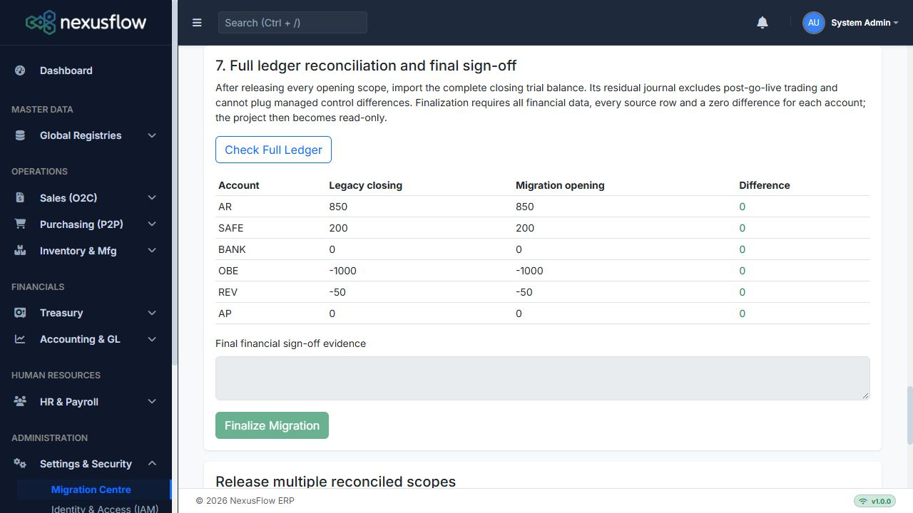

# Migration Centre implementation verification — 6 October 2026

Status: implemented and verified locally with synthetic data. Hosted authenticated UAT and business acceptance remain pending. No supplied private spreadsheet was financially imported; no hosted deployment was performed.

## Evidence

- Full solution Release suite: **97 passed, 0 failed, 1 skipped, 98 total**, both LocalDB feature flags enabled. The skipped check is the optional private-file assessment; database import/rollback/concurrency checks ran. TRX: `NexusFlow.IntegrationTests/TestResults/migration-complete.trx` (local generated output).
- Schema checks: forward upgrades from the June financial baseline and the hardened customer-migration baseline, repeated idempotent SQL, preserved four new temporal tables, and no pending EF model changes. The two-baseline check has a separate local TRX, `migration-upgrade-baselines.trx`.
- Seven client tests passed (four existing raw-material checks and three supplier-opening payment checks, including escaped references and bill/opening-ID collision protection); syntax checks passed for six new/touched migration, party and treasury scripts.
- Synthetic loopback MVC test: actual Razor/controller activation using production AppCore registrations, twelve template contracts, permission/CSRF rejection, staged originals with no journals, approval, real migration job execution, negative credits and separate safe cheques, independent release, exactly-once replay, legacy posting retirement, residual GL and final read-only state. SQL tests also verify that pre-go-live financial dates remain prohibited after finalization, while subsequent normal trading no longer requires scope classification. The test target is fixed to localhost and cannot accept a hosted URL.
- Browser: actual `/Migration` and **Administration → Settings & Security → Migration Centre** navigation verified. Saved finalized project loaded all seven steps; **Upload Dataset** and **Finalize Migration** were disabled. **Check Full Ledger** displayed six closing accounts with zero difference. Screenshot below contains synthetic data only.
- Hosted `https://nexus.garnetnation.lk/` reached **Sign In**. No authenticated credentials were supplied; this does not verify the deployed wizard or hosted role claims.



The local HTTP harness substitutes an in-memory background dispatcher and original-file storage while invoking the real application migration job and SQL transactions. It does **not** establish hosted Hangfire SQL persistence/restart recovery or hosted secure-storage availability. Verify both after deployment. Existing layout notification scripts report missing notification services in the isolated harness; central migration interactions completed successfully.

## Reproduce locally

```powershell
$env:NEXUSFLOW_RUN_LOCALDB_CUSTOMER_TESTS='1'
$env:NEXUSFLOW_RUN_LOCALDB_IMPORT_TESTS='1'
dotnet test NexusFlow_ERP.sln -c Release --no-restore
node --test NexusFlow.IntegrationTests/raw-material-import.client.test.cjs NexusFlow.IntegrationTests/supplier-opening-payments.client.test.cjs
dotnet run --project tools/MigrationCentreSmokeHost/MigrationCentreSmokeHost.csproj -c Release
# In a second terminal:
python tools/MigrationCentreSmokeHost/smoke.py
```

The opt-in host binds `http://127.0.0.1:5191`; `/smoke-login` creates a synthetic session. Run the HTTP script once against a fresh harness database. POST `/smoke-stop` to stop it and delete only its GUID-owned LocalDB test database. It does not read the normal application connection settings. Do not package or deploy this test host.

## Hosted and business gates

Use [MC-01 through MC-22](UAT_Test_Cases.md) after deploying application and `20261006160821_AddMigrationCentre`. Record tester, date, pass/fail and evidence; automated results do not fill the hosted acceptance column. Obtain current same-date closing files, complete TB/AP/bank schedules and valuation reconciliation. The actual go-live date, sparse-master defaults, warehouse/UOM dictionary, supplier due treatment, cheque reflection/custody and archive/supporting schedules require business confirmation where not supplied.

A local publish still reports existing nullable/analyzer warnings and the existing Microsoft.OpenApi 2.0.0 NU1903 advisory. Dependency remediation is outside this migration change; the artifact records it for release review. There is no claim of a warning-free or business-approved production release.

Operations: [Migration Centre operating guide](../migration/Migration_Centre_Runbook.md). Deployment: [UAT update](../installation/UAT_Update_Migration_Centre.md).
