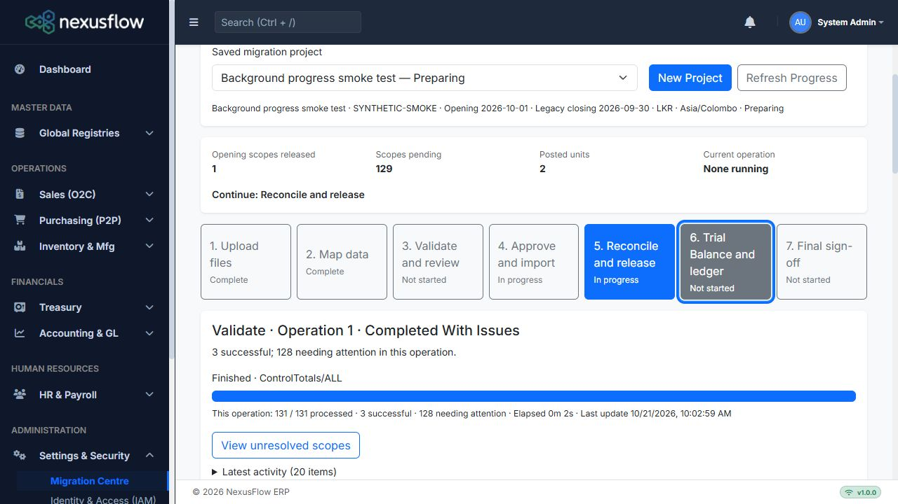

# Migration Centre operations verification — 2026-10-21

Local implementation verification. These results do not constitute authenticated hosted business acceptance. No deployment, hosted SQL, financial write, reset, reopening, history purge or temporal-setting change was performed against the hosted system. Finalized hosted project **3 / Data Migrate**, source **TESTTTT**, opening **2026-10-01** / closing **2026-09-30**, remains outside all write tests.

## Automated results

| Check | Result | Evidence |
|---|---|---|
| Migration Centre regression suite | **37 passed, 0 failed, 0 skipped** | `dotnet test NexusFlow.IntegrationTests/NexusFlow.IntegrationTests.csproj --no-restore -m:1 /nodeReuse:false /p:UseSharedCompilation=false --filter 'FullyQualifiedName~MigrationCentre'`; final duration approximately 73 seconds. |
| Application and smoke-host build | **Passed, 0 errors** | `dotnet build tools/MigrationCentreSmokeHost/MigrationCentreSmokeHost.csproj --no-restore -m:1 /nodeReuse:false /p:UseSharedCompilation=false`; compiler warnings remain (21 on the final build). |
| Real HTTP contract/permission checks | **32 assertions passed** | `tools/MigrationCentreSmokeHost/VerifyOperations.ps1`, against a fresh opt-in synthetic loopback fixture only. |
| JavaScript parse | **Passed** | `node --check NexusFlow.Web/wwwroot/js/migration/centre.js`. |
| Patch whitespace | **Passed** | Repository-default `git diff --check`. |
| Additive upgrade/model | **Passed** | Existing upgrade coverage plus temporal-on/off legacy MigrationRuns, idempotent script applied twice, finalized/source/unit/scope/run/history preservation, six actual non-temporal new tables and no pending model changes. |

The suite includes the existing financial, workflow, performance, cheque and dashboard coverage. New operation cases cover:

- Durable validation → approval → import; exact selected-unit totals; initiating identity retained when the worker's current user is SYSTEM; immutable request/preview/run storage and import detail retrieval.
- Concurrent same-request submissions returning one operation, distinct competing requests blocked, legacy execution/mutation guards, and duplicate completed job delivery producing no additional posting.
- Accepted enqueue outages retained for dispatcher recovery; active/unavailable/missing/stopped job distinctions; worker-lock confirmation; changed-input rejection; a newly enqueued worker finding the inactivity-probe lock already released.
- A synthetic **2,050-customer-scope** zero-opening release interrupted exactly after **223 committed releases**. A new service scope reopens it with **1,827 pending**, resumes and finishes with **2,050 releases and 2,050 release audit records**, with no duplicate journal effect. The operation target remains 2,050 throughout. This is a mechanics/scale fixture, not a claim that the real mixed pilot was replayed.
- Partial business failure: C001 succeeds while C002's independently supplied debit is 199 instead of 200; C002 stays pending and the operation is CompletedWithIssues.
- Validation warning grouping for 125 source rows, bounded result/detail pages, an API maximum of 100, and polling that leaves operation update time, audit count and immutable payload unchanged.
- Saved per-account ledger results and background finalization completing with the finalized project state; duplicate delivery and subsequent import cannot reopen it.

The HTTP verifier exercises 202/status URLs and repeated client IDs; real query binding for page 2, kind/status/module/search and the 100-row cap; grouped severity filters; source/journal details before and after import; run-state filters and operation ownership; selected import/release; initiating approval identity; view-only/prepare-only denial of Release and its Resume; and a fresh-cookie write without antiforgery returning HTTP 400. A paging-object parameter-name collision found in browser testing was fixed and is covered by these HTTP assertions.

## Browser evidence

@Browser was used against the loopback Migration Centre smoke host, which owns a GUID-named disposable LocalDB database and clears hosted connection configuration. Its staged fixture has C001/C002 and deliberately unmapped synthetic customer codes.

| Observed behavior | Result |
|---|---|
| Submission feedback and refresh recovery | Starting… appeared immediately with the action disabled; refresh rediscovered the saved validation operation/results. |
| Focused stage panels and overview | Seven revisitable stages, persistent actual project counts and separate operation totals rendered in the existing theme. |
| Release lists/selections/forms | Page 2 showed 25 rows; one selection across pages, current stage, page number and draft evidence survived refresh. |
| Connectivity | Stopping the local host retained 131/131, 3 successful and 128 attention values and showed Connection lost—checking progress. It did not label transport loss as job failure. |
| Keyboard focus | Tab from stage 5 focused stage 6; computed outline was a solid 3px, visibly retained in the screenshot. |
| Responsive spot checks | Actual application rendered inside 375, 768, 1024 and 1440px smoke frames; narrow progress/stage controls wrapped legibly. The 1440px frame extended past the 1280px automation window, so full wide-device inspection remains a manual acceptance check. |

[Desktop screenshot](screenshots/migration-background-desktop.png) · [375px progress screenshot](screenshots/migration-background-375.png)

The reduced-motion CSS rule, progressbar values, labelled controls, polite status messages and error alerts are present. Real screen-reader announcements and an operating-system reduced-motion preference still require manual UAT; no assistive-technology pass is claimed.

## Hosted boundary and remaining acceptance

On 2026-10-21 @Browser reached [the hosted application](https://nexus.garnetnation.lk/) and its **Sign In** page. No authenticated session was available. Hosted page/workflow verification of this unreleased feature is therefore pending; no hosted UI acceptance or financial validation is claimed.

Complete MC-BG-01 through MC-BG-19 in [UAT Test Cases](UAT_Test_Cases.md) using a separate disposable UAT environment. In particular, retain human acceptance for the mixed pilot shape (896 customers, 215 suppliers, 938 stock scopes, 1 bank scope), certified closing schedules, actual hosted role assignments, assistive technology and final sign-off authority. Those business decisions are **Needs business confirmation**.

Review [the implementation/operation guide](../migration/Migration_Centre_Background_Operations.md) and [additive rollout instructions and SQL](../installation/UAT_Update_Migration_Operations.md). Deployment must wait for idle workers/writers and separate authorization. Existing finalized data and actual temporal settings are preserved by the additive upgrade.
